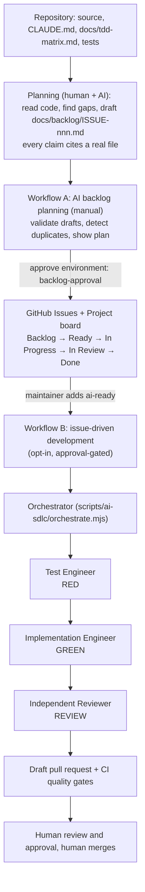

# AI-driven SDLC

A small, GitHub-native pipeline that connects **requirements → GitHub Issues → TDD → implementation → independent review → CI → pull request → human approval**. It is deliberately modest: manual triggers, no agent framework, no auto-merge, and nothing that touches the application's business logic.

> **Status:** the tooling is implemented and locally tested with a fake agent CLI (`test/ai-sdlc.test.ts`, 25 tests) and the workflows pass `actionlint`. It has **not** been run on GitHub, and the orchestrator has **not** been run against a real model (no API key and no repository access in the build environment). See [Validation evidence](#8-validation-evidence).

## 1. Architecture

The three agents are Claude Code subagent definitions in `.claude/agents/`. They reference `CLAUDE.md` and the existing skills (`test-strategy`, `financial-correctness`, `code-review`) and do not restate them.

## 2. What existed and what was added

| Capability | Before | Added here |
|---|---|---|
| Engineering principles, financial rules | `CLAUDE.md` | branch/PR rule (never commit to `main`, only an approved PR merges) |
| Skills | `financial-correctness`, `test-strategy`, `code-review` | none |
| Agents | none | `test-engineer`, `implementation-engineer`, `independent-reviewer` |
| CI quality gates | `ci.yml` (format, lint, types, tests on PostgreSQL, audit, secrets, docker, terraform) | none (PRs from the workflow run the same gates) |
| PR template, Dependabot | present | AI-run fields in the PR template |
| Requirements → tests | traceability doc | `docs/tdd-matrix.md` (IDs, invariants, coverage, gaps) |
| Backlog | none | `docs/backlog/ISSUE-001…006` (evidence-backed drafts) |
| Issue intake | none | `.github/ISSUE_TEMPLATE/task.yml` (issue form) |
| Labels | none | 11 labels defined once in `scripts/ai-sdlc/lib.mjs` |
| Workflows | CI only | A: backlog planning; B: issue-driven development |
| Handoff validation | none | `orchestrate.mjs` and the role scope guard, both tested |
| Transcripts | capture hook + gate for Claude Code | run records, hook output committed with each run, gate understands run folders |

## 3. Who may change what (enforced, not requested)

| Role | May change | Must pass before handoff |
|---|---|---|
| Test Engineer | `test/**`, the matrix row | the new test **fails with an assertion** (a syntax/import error is rejected as `red_invalid`); or, in `characterize` mode, **passes** |
| Implementation Engineer | `src/**`, `migrations/**`, `docs/**`. Never tests, workflows, agent config, `scripts/**`, package or tooling files, `CLAUDE.md` | the new test passes; the full `npm run verify` passes |
| Independent Reviewer | nothing (no edit tools; any change is a violation) | returns a parsable `REVIEW_JSON` line; any **P0** blocks the PR |

After each agent turn the orchestrator computes the changed files from `git diff` and checks them against these rules (`ROLE_RULES` in `scripts/ai-sdlc/lib.mjs`). A prompt that is ignored or injected cannot widen the scope. Agents run one after another and never edit the same files at the same time. For behaviour that already works use `characterize` mode; the orchestrator never asks an agent to break working code to produce a RED.

Every run result is one of: `ready_for_pr`, `red_invalid`, `scope_violation`, `green_failed`, `review_blocked`, `defect_found` (a characterization test failed: the assumption in the issue is wrong, a human decides) or `error`.

## 4. Labels and project statuses

Labels (created by `scripts/ai-sdlc/sync-labels.mjs`, or by the publish job): `priority/P0|P1|P2`, `type/bug|test|enhancement`, `ai-proposed`, `ai-ready`, `ai-in-progress`, `ai-blocked`, `needs-decision`.

Project (GitHub Projects v2) columns, mapped by hand or with the project's built-in automations; nothing in the repository can create a project:

| Status | Meaning | Moves there when |
|---|---|---|
| Backlog | filed, not reviewed | the issue is added (built-in "item added") |
| Ready | a human reviewed it and added `ai-ready` | a maintainer decides |
| In Progress | `ai-in-progress` | workflow B starts |
| In Review | draft PR open | the PR is opened |
| Done | merged and closed | built-in "PR merged / item closed" |

`ai-ready` is a **human decision**. Neither workflow ever adds it, and an issue labelled `needs-decision` or `ai-blocked` is refused.

## 5. The workflows

**A. AI backlog planning** (`.github/workflows/ai-backlog-planning.yml`, `workflow_dispatch` only). The planning step is a human-plus-AI activity done in the repository (an AI session reads the code and drafts `docs/backlog/ISSUE-nnn-*.md`). The workflow then:
1. validates every draft: required sections, a priority and type, at least one acceptance-criteria checkbox, and **every file cited as evidence must exist** (speculative issues are rejected);
2. compares each draft with all existing issues **and PRs** (by backlog id, identical title or near-identical title);
3. prints the plan in the job summary and uploads it. Nothing is created.
4. With `publish: true`, a second job waits for approval of the `backlog-approval` environment (required reviewers = the human gate), re-plans from the same commit, re-checks duplicates immediately before each create, and files only the **new** issues, labelled `ai-proposed`.

It makes no AI API call, so it costs nothing.

**B. Issue-driven development** (`.github/workflows/ai-issue-development.yml`; trigger: a maintainer adds `ai-ready`, or `workflow_dispatch`).
1. `authorize`: the actor must have write access; the issue must be open, not `needs-decision`/`ai-blocked`, and carry `ai-ready` (for the label trigger). Read-only permissions.
2. `develop` runs **only if** the repository variable `AI_EXECUTE_ENABLED` is `true`, **and** the `ai-execution` environment is approved (required reviewers), **and** `ANTHROPIC_API_KEY` is set. It installs the pinned Claude Code CLI, runs the orchestrator on an isolated branch `ai/issue-N-slug`, uploads the run records and session transcripts as an artifact, then pushes only that branch and opens a **draft** PR (or, if the repository forbids Actions-created PRs, comments a compare link). On any failure it labels the issue `ai-blocked`, pushes nothing and says so.
3. It never merges, never pushes to the default branch, and has no auto-merge. A guardrail test fails if a workflow ever contains `gh pr merge`, `--auto`, `pull_request_target`, force-push or an untrusted field in an expression.

Cost control: each agent run is capped with `--max-budget-usd` (default $2, three runs per issue at most).

## 6. Security model

* **Issue text is untrusted data.** It is sanitized (control characters removed, size capped), wrapped in a fence that its own content cannot close, labelled as untrusted in every prompt, and never interpolated into a shell command or workflow expression (it travels through files and environment variables).
* **Least privilege.** Workflows start with `permissions: {}`; each job declares only what it needs. `authorize` is read-only; only `develop` can write, and only after approval.
* **Agents get no repository credentials.** The orchestrator removes `GH_TOKEN`/`GITHUB_TOKEN` from the agents' environment; checkout uses `persist-credentials: false` so the token is not in `.git/config`; the token is supplied only to the push step. Agent shell access is an allowlist (`npx vitest`, `npm run`, read-only `git`); the reviewer has no edit tools.
* **Human gates:** the `ai-ready` label, two environment approvals, and the final PR review and merge.
* **Pinned actions** (full SHAs) and a pinned CLI version.
* **Recommended repository settings** (not set by any file here): protect `main` (require a PR, one approving review, the CI checks, no force pushes), require approval for `ai-execution` and `backlog-approval` environments, restrict who can add labels.

## 7. Traceability and transcripts

GitHub Actions logs alone do **not** satisfy the "every prompt and response" requirement, so three layers are used:

| Layer | What it captures | Completeness | Where |
|---|---|---|---|
| Orchestrator record | the exact prompt sent to each agent, the agent's raw output, session id, cost, files changed, every command and its exit code and output tail, review findings | **Complete for the orchestrator ↔ agent exchange** (by construction, verbatim) | `ai-logs/runs/issue-N/<run-id>/` (committed with the PR) |
| Claude Code session transcript | the full session including tool calls and subagent activity | Written by the existing `Stop`/`SubagentStop` hook into `ai-logs/claude-code/` and also uploaded as a workflow artifact. **Whether headless `-p` runs trigger the project hooks is unverified** (needs a real run) | `ai-logs/claude-code/*.jsonl`, workflow artifact |
| claude.ai chat | planning and interactive work | **Manual export by the owner** (see `PROMPTS.md`); not obtainable by tooling | `ai-logs/claude-ai/` |

Association: every commit made by a run carries `Refs: #N` and `AI-Run: <run-id>` trailers; the PR body names the run; `run.json` lists session ids, commands and results. `npm run check:ai-logs` requires each file under `ai-logs/` to be referenced from `PROMPTS.md` (a run folder can be referenced as one directory). Redaction is never silent: if a secret must be removed, say so in `PROMPTS.md`.

**Limit, stated plainly:** subagents spawned *inside* an interactive chat (as in the first slice of this repository, see the worked example) return only their final message to the orchestrating assistant, so their internal tool calls are not available. For those, only the exact prompts and the returned reports are preserved.

## 8. Validation evidence

| Item | How it was checked | Result |
|---|---|---|
| Backlog validation, duplicate detection, untrusted-text handling, scope guard, PR body, label/issue publishing | `test/ai-sdlc.test.ts` (25 tests, no database needed) | pass |
| Orchestrator: RED/GREEN/REVIEW handoffs, scope violations, setup-error RED, P0 block, unsafe start conditions, characterize mode, credential stripping, `is_error` handling, hook-file handling | same file, with a fake agent CLI and temporary git repositories | pass |
| Safety checks really matter | 5 manual mutations (scope guard off, RED check off, token leak, P0 ignored, `ai-ready` added) | each caught by a specific test |
| Workflow guardrails (no untrusted expressions, no merge, SHA pins, opt-in execution) | static tests; also proven to fail on a deliberately bad workflow | pass |
| Workflow syntax and expression typing | `actionlint` 1.7.12 on all three workflows | clean (shellcheck was not installed, so embedded shell was not shell-checked) |
| CLI flags used by the orchestrator | pinned CLI `@anthropic-ai/claude-code@2.1.316` installed in a scratch directory: `-p`, `--output-format json`, `--allowedTools`, `--permission-mode`, `--max-budget-usd` accepted; unknown flags rejected; JSON output has `result`, `session_id`, `is_error`, `total_cost_usd` | confirmed. A first draft used `--max-turns`; it is accepted but undocumented, so `--max-budget-usd` is used instead |
| **A real model run** | not possible without an API key | **not validated** |
| Workflows on GitHub, environments, label trigger, draft-PR creation, hooks in headless mode | no repository access from the build environment | **not validated** |

Known limitations: a PR opened with the default `GITHUB_TOKEN` does not start CI by itself (GitHub rule), so a human must push or reopen to trigger it, or the workflow must be switched to a fine-grained token or GitHub App; the PR checklist says so. The planning step that drafts `docs/backlog/*.md` is an AI-assisted manual step, not an automated one.

## 9. Setup guide (owner, about ten minutes)

1. Push the branch and open a PR from it into `main` (nothing was pushed for you). Review and merge it yourself.
2. In the repository settings: protect `main` (PR + 1 approval + the CI checks); create environments `backlog-approval` and `ai-execution` with **yourself as required reviewer**.
3. Create the labels: `node scripts/ai-sdlc/sync-labels.mjs` (needs `gh auth login`), or run workflow A with `publish`.
4. Run **AI backlog planning** from the Actions tab (leave `publish` off first and read the summary), then run it again with `publish: true` and approve.
5. Read the new issues. Add `ai-ready` only to the ones you accept (ISSUE-004 and ISSUE-006 are `needs-decision`).
6. To enable AI execution: add the `ANTHROPIC_API_KEY` secret and set the variable `AI_EXECUTE_ENABLED=true`. Optional: in *Settings → Actions → General*, allow Actions to create pull requests.
7. Add `ai-ready` to one issue; approve the `ai-execution` environment; review the draft PR; merge it yourself.

You can run the same orchestrator locally with the real CLI: `node scripts/ai-sdlc/orchestrate.mjs --issue-file issue.json` (needs a clean tree, PostgreSQL and `ANTHROPIC_API_KEY`).
